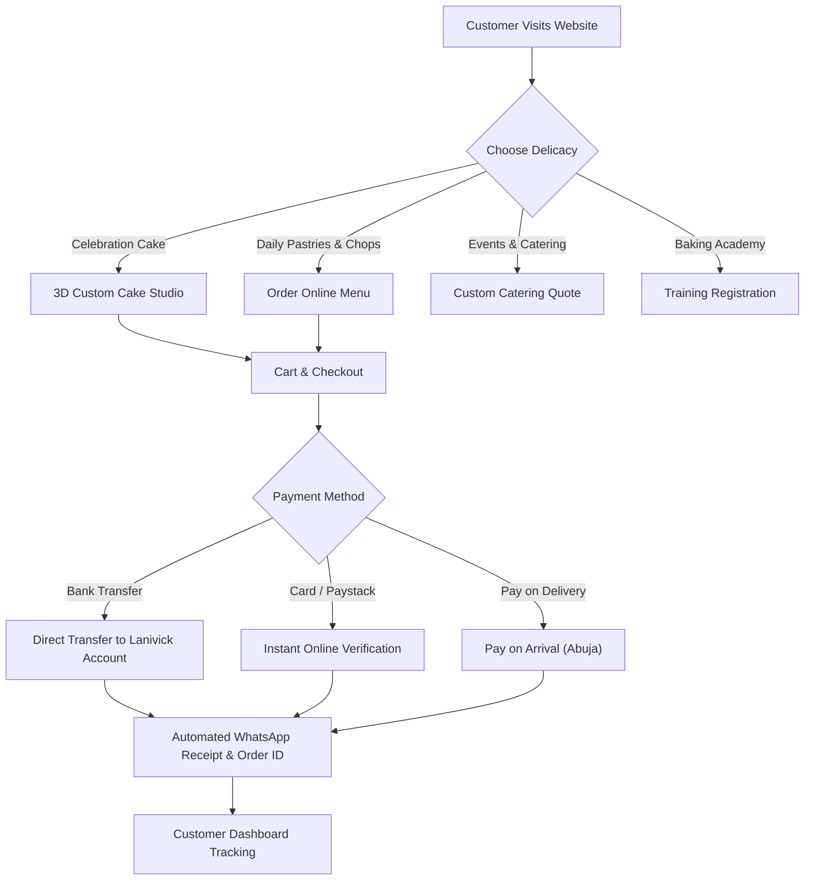
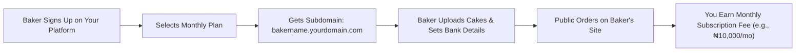

# 🎂 Plain-English Operational & Packages Guide: Lanivick Confectionary

A plain-English operational manual for **Danladi Victoria Lanishe (CEO & Founder)**, store administrators, and developers.

This guide provides clear answers to:
1. **How people (customers) and the admin start to actually use the platform.**
2. **How to get rid of the demo data to start working with real customers.**
3. **Which files in the source code hold the images if you need to change them manually.**
4. **How to set the right bank account details so money goes to the correct account.**
5. **How packages work in this product and how to reproduce/sell it as a recurring subscription or package model.**

---

## 1. How Customers & Admin Actually Start Using It

### A. How Customers Use the Platform

The customer experience is streamlined for fast ordering on mobile phones and laptops:



1. **Ordering Cakes & Bento Boxes**:
   - The customer visits the website and navigates to **Cakes & Pastries** or **Order Online**.
   - For bespoke celebration cakes, they click **"Open Custom Cake Builder"**. They select the sponge flavour (from Victoria's 8 signature flavours: Coconut, Strawberry, Banana Bread, Banana Cake, Red Velvet, Vanilla, Chocolate, Marble), size (6" Bento to 2-Tier Grand), fillings, frostings, and type their personalized inscription (e.g., *"Happy 30th Birthday Chinedu"*).
   - They can even upload a reference cake photo from Pinterest or Instagram.
   - When added to the cart, pricing updates in real-time.

2. **Ordering Pastries, Chops & Drinks**:
   - Customers can add freshly baked beef meat pies, sausage rolls, VIP small chops platters (50 or 100 pieces), fresh zobo infusions, and Greek yogurt parfaits to their bag.

3. **Checkout & Fulfillment**:
   - Customers choose between:
     - **Doorstep Delivery (Abuja)**: Pyakasa, Airport Road Corridor, Wuse, Maitama, Garki, Gwarinpa, etc.
     - **Free Self-Pickup**: At Lanivick Bakery Hub (**Area G, Pyakasa, off Airport Road, Abuja**).
   - They pick their preferred date and delivery window (Morning, Afternoon, Evening).
   - They choose payment: **Bank Transfer**, **Card / Paystack**, or **Pay on Delivery**.
   - Upon placing the order, celebratory confetti triggers, an official Order ID (e.g., `#LAN-89241`) is created, and an instant **"Confirm & Send Receipt via WhatsApp"** button opens a pre-formatted receipt directly to Victoria's WhatsApp (`0916 222 6176`).

4. **Event Catering & Academy Enquiries**:
   - For weddings, birthdays, or office breakfasts, organizers submit a **Catering & Event Quote** request.
   - Aspiring bakers apply for **Baking & Pastry Training** directly through the interactive form.

---

### B. How Victoria (Admin) Actually Uses It

1. **Accessing the Admin Portal**:
   - Visit `/admin` in the browser (or click **"Admin Portal"** in the footer).
   - You can also switch user roles directly in the header avatar to test the view.

2. **Managing Live Orders**:
   - Under the **Orders** tab, new customer orders appear with their customer name, phone number, address, ordered items, and payment status.
   - Victoria verifies that the bank transfer has hit her account, then updates the status dropdown:
     `Pending` ➔ `Confirmed` ➔ `Preparing` ➔ `Ready` ➔ `Out for Delivery` ➔ `Completed`.
   - Victoria can click the green **WhatsApp button** next to any order to send an automated order update message to the customer.
   - She can click **"Print Receipt"** to print out kitchen slips or delivery packaging stickers.

3. **Managing Menu, Stock & Prices**:
   - Under the **Menu & Inventory** tab, Victoria can:
     - Toggle any item **"In Stock"** or **"Out of Stock"** with 1 click (e.g., when morning meat pies sell out).
     - Click **"Add New Product"** to create a new cake, pastry, drink, or package with price, description, and photo.
     - Edit prices or delete outdated items.

4. **Managing Quotes & Training Inquiries**:
   - Review incoming event catering requests and training applicants.
   - Click to chat directly with organizers or students on WhatsApp.

5. **Updating Store Settings**:
   - Under the **Settings** tab, Victoria can update:
     - Bank Name, Account Number, and Account Name.
     - Delivery fees for Pyakasa local vs. Greater Abuja.
     - Bakery operating hours and phone numbers.
     - The top announcement ticker bar.
   - All changes take effect across the entire website instantly.

---

### C. How to Put It Live on the Internet

To make the platform accessible to everyone on the web:
1. **GitHub**: Push your code to a GitHub repository:
   ```bash
   git init
   git add .
   git commit -m "Launch Lanivick Confectionary"
   git push -u origin main
   ```
2. **Vercel or Netlify (Free Hosting)**:
   - Go to [vercel.com](https://vercel.com) and click **"Add New Project"**.
   - Connect your GitHub repo.
   - Framework preset: **Vite**.
   - Build Command: `npm run build`.
   - Output Directory: `dist`.
   - Click **Deploy**.
3. **Custom Domain**:
   - In Vercel, go to **Settings ➔ Domains**.
   - Connect your custom domain (e.g., `lanivickconfectionary.com` or `lanivick.ng`).

---

## 2. How to Get Rid of Demo Info to Work with Real Customers

The project currently comes with realistic starter data so you can test all views immediately. When you are ready to take real orders from real people:

### Step 1: Clear the Browser Local Storage
The app stores state changes in your browser's LocalStorage. To start with a fresh slate:
- Open your browser's Developer Tools (press `F12` or right-click ➔ Inspect).
- Go to the **Application** or **Storage** tab.
- Click **Local Storage** ➔ right-click your domain ➔ click **Clear**.

### Step 2: Empty the Initial Demo Arrays in Source Code
Open [`src/services/dataService.ts`](file:///C:/Users/MANYUBS/.gemini/antigravity/scratch/lanivick-platform/src/services/dataService.ts):
- To clear demo orders:
  Change `export const INITIAL_ORDERS: Order[] = [...]` to:
  ```typescript
  export const INITIAL_ORDERS: Order[] = [];
  ```
- To clear demo event catering quotes:
  Change `export const INITIAL_CATERING_REQUESTS: CateringRequest[] = [...]` to:
  ```typescript
  export const INITIAL_CATERING_REQUESTS: CateringRequest[] = [];
  ```
- To clear demo training enquiries:
  Change `export const INITIAL_TRAINING_ENQUIRIES: TrainingEnquiry[] = [...]` to:
  ```typescript
  export const INITIAL_TRAINING_ENQUIRIES: TrainingEnquiry[] = [];
  ```
- To clear demo partnership requests:
  Change `export const INITIAL_PARTNERSHIP_ENQUIRIES: PartnershipEnquiry[] = [...]` to:
  ```typescript
  export const INITIAL_PARTNERSHIP_ENQUIRIES: PartnershipEnquiry[] = [];
  ```

### Step 3: Connect to a Live Production Database (Supabase / PostgreSQL)
When you want orders to persist across multiple staff computers:
- Run the SQL file in [`database/schema.sql`](file:///C:/Users/MANYUBS/.gemini/antigravity/scratch/lanivick-platform/database/schema.sql) in your [Supabase](https://supabase.com) SQL editor.
- This creates the tables: `orders`, `order_items`, `products`, `catering_requests`, `training_enquiries`, `partnership_enquiries`, and `settings`.
- Add your Supabase credentials into your `.env` file:
  ```env
  VITE_SUPABASE_URL=https://your-project.supabase.co
  VITE_SUPABASE_ANON_KEY=your-anon-key
  ```

---

## 3. Which Files in the Source Code Hold Images & How to Change Them

All imagery is cleanly organized across three main locations:

### 1. Static Photos of the CEO & Bakery:
- **Location**: [`public/images/`](file:///C:/Users/MANYUBS/.gemini/antigravity/scratch/lanivick-platform/public/images/)
- **Key Files**:
  - `ceo-lanishe-pink.jpg` — The official portrait of Victoria in pink, used in the Hero Section and About Page.
  - `logo.png` — Brand logo.
- **How to replace manually**:
  - Simply drop your new photo into `public/images/` with the same name (or a new name like `ceo-victoria.jpg`), then reference it in code as `/images/ceo-victoria.jpg`.

### 2. Product Catalog & Menu Images:
- **Location**: [`src/services/dataService.ts`](file:///C:/Users/MANYUBS/.gemini/antigravity/scratch/lanivick-platform/src/services/dataService.ts)
- Inside `INITIAL_PRODUCTS`, each item has an `image:` property. For example:
  ```typescript
  {
    id: 'cake-vanilla-luxury',
    name: 'Vanilla Celebration Crown Cake',
    image: 'https://images.unsplash.com/photo-1535141192574-5d4897c13136?w=700...',
  }
  ```
- **How to replace manually**:
  - **Option A (Web URLs)**: Paste any high-resolution image link from Cloudinary, ImgBB, Unsplash, or your Google Cloud Storage.
  - **Option B (Local Photos)**: Place your photos in `public/images/cakes/` and set:
    `image: '/images/cakes/vanilla-crown.jpg'`

### 3. Gallery Showcase Images:
- **Location**: [`src/services/dataService.ts`](file:///C:/Users/MANYUBS/.gemini/antigravity/scratch/lanivick-platform/src/services/dataService.ts) inside `INITIAL_GALLERY`.
- Update the `image:` URLs to showcase your latest real cakes and pastries baked at the Pyakasa hub.

### 4. Page Banners & Features:
- [`src/pages/Home.tsx`](file:///C:/Users/MANYUBS/.gemini/antigravity/scratch/lanivick-platform/src/pages/Home.tsx) — Hero banner and CEO spotlight cards.
- [`src/pages/About.tsx`](file:///C:/Users/MANYUBS/.gemini/antigravity/scratch/lanivick-platform/src/pages/About.tsx) — Founder story and kitchen spotlight.
- [`src/pages/Catering.tsx`](file:///C:/Users/MANYUBS/.gemini/antigravity/scratch/lanivick-platform/src/pages/Catering.tsx) — Event packages and training cards.

---

## 4. Setting the Correct Bank Account Details for Payments

There are two easy ways to set Victoria's verified Nigerian bank details:

### Method A: Directly from the Admin Portal (No Coding Required)
1. Visit `/admin` in your browser.
2. Click the **Settings** tab.
3. Scroll down to **"Bank Settlement Details"**:
   - **Bank Name**: e.g., `Guaranty Trust Bank (GTBank)` or `Zenith Bank`
   - **Account Number**: your 10-digit NUBAN account number
   - **Account Name**: e.g., `Danladi Victoria Lanishe` or `Lanivick Confectionary`
4. Click **"Save Settings"**.
5. Customers choosing "Bank Transfer" at checkout will immediately see this exact account and can copy it with 1 click!

### Method B: In the Source Code File
Open [`src/services/dataService.ts`](file:///C:/Users/MANYUBS/.gemini/antigravity/scratch/lanivick-platform/src/services/dataService.ts) and edit lines 20–22 in `INITIAL_SETTINGS`:
```typescript
export const INITIAL_SETTINGS: StoreSettings = {
  businessName: 'Lanivick Confectionary',
  slogan: 'Premium Taste, Healthy Treats and Perfect Craft',
  whatsappNumber: '2349162226176',
  callPhone: '+234 916 222 6176',
  email: 'lanivick555@gmail.com',
  address: 'Area G, Pyakasa, off Airport Road, Abuja, Federal Capital Territory, Nigeria',

  // 👉 YOUR REAL SETTLEMENT BANK ACCOUNT DETAILS:
  bankName: 'YOUR_BANK_NAME',
  accountNumber: 'YOUR_ACCOUNT_NUMBER',
  accountName: 'YOUR_ACCOUNT_NAME',

  deliveryFeePyakasa: 1500,
  deliveryFeeAbuja: 2500,
  // ...
};
```

### Method C: Enabling Automated Card Payments via Paystack
If Victoria wants customers to pay using ATM cards, USSD, or automated bank transfer:
1. Create a free account at [paystack.com](https://paystack.com).
2. Get your **Public Key** from the Paystack Dashboard (e.g. `pk_live_xxxx...`).
3. Add it to your `.env` file:
   ```env
   VITE_PAYSTACK_PUBLIC_KEY=pk_live_xxxxxxxxxxxxxxxxxxxx
   ```
4. Card payments will automatically credit Victoria's bank account directly through Paystack.

---

## 5. Packages & Subscriptions: How They Work & How to Reproduce Them

You asked:
> *"Can I reproduce this product into one that another client would have to purchase via subscription/packages? If yes, teach/show me how to implement the features for packages. If no, is the package feature already in this product?"*

### Part 1: Are Packages Already in This Product?
**YES! Packages are already fully built into Lanivick Confectionary.**
In our product architecture:
1. **Product Category `packages`**:
   - `Complete Birthday Celebration Package` (₦45,000): 8" decorated cake, 6 cupcakes, 2 fresh juices, candles & gold topper.
   - `Executive Confectionery Gift Box` (₦25,000): Banana bread loaf, chin-chin jar, chocolate brownies, natural juice.
   - `Individual Office Breakfast Boxes` (₦4,000/box).
   - `Lanivick VIP Small Chops Platters` (50 and 100 piece party trays).
2. **Corporate & School Partnership Packages**:
   - Under `/services`, institutions (schools, churches, corporate offices) can subscribe to **"Regular Snack Supply"** (e.g. weekly snack supply every Wednesday and Friday).
3. **Baking Academy Masterclasses**:
   - 4 modular training packages (Baking Fundamentals, Pastries & Meat Pies, Cake Decoration, Complete Masterclass).

---

### Part 2: How to Implement Recurring Subscriptions (e.g., Weekly Breakfast Box)

To enable automatic recurring charges (e.g., a corporate office paying ₦20,000 every Monday for 5 breakfast boxes):

#### Step 1: Add a `SubscriptionPlan` Type in `src/types/index.ts`
```typescript
export interface SubscriptionPlan {
  id: string;
  name: string; // e.g. "Weekly Executive Breakfast Club"
  frequency: 'weekly' | 'biweekly' | 'monthly';
  price: number;
  itemsIncluded: string[];
  paystackPlanCode?: string; // from Paystack recurring plans
}

export interface UserSubscription {
  id: string;
  userId: string;
  planId: string;
  deliveryDay: 'Monday' | 'Wednesday' | 'Friday';
  status: 'active' | 'paused' | 'cancelled';
  nextDeliveryDate: string;
}
```

#### Step 2: Use Paystack Subscriptions API
Paystack natively supports recurring billing in Nigeria:
1. In your Paystack Dashboard ➔ **Subscriptions** ➔ **Create Plan** (e.g. `Weekly Breakfast Pack`, ₦16,000/week). Paystack gives you a Plan Code (`PLN_xxxx`).
2. When the customer checks out, initialize Paystack with the plan code:
   ```javascript
   const handler = PaystackPop.setup({
     key: 'pk_live_xxxx',
     email: customerEmail,
     amount: 16000 * 100,
     plan: 'PLN_xxxx', // 👈 Automatically charges every week!
     callback: function(response) {
       // Save active subscription in database
     }
   });
   handler.openIframe();
   ```

---

### Part 3: How to Reproduce This Platform as a Software Product (SaaS) for Other Clients

You can package and sell this exact digital product to other bakeries, restaurants, caterers, and food brands. There are two highly lucrative business models:

#### Model 1: White-Label Agency Reselling (Fastest Cash Flow)
Sell this exact website to other bakery owners (e.g., in Lagos, Port Harcourt, Ibadan, or London):
1. **What You Charge**:
   - **Setup & Branding Fee**: ₦150,000 – ₦350,000 ($200–$450) one-time.
   - **Monthly Maintenance & Hosting Retainer**: ₦15,000 – ₦30,000/month.
2. **How to Deliver in 1 Hour**:
   - Duplicate this project folder.
   - In `src/services/dataService.ts`: Change brand name, logo, phone, colors, and products.
   - Deploy to Vercel on the client's custom domain.
   - Hand over the `/admin` portal login to the client.

#### Model 2: Multi-Tenant SaaS ("Shopify for African Bakeries")
Turn this platform into a cloud software where any baker can register and get their own online store:



**Architecture to Implement**:
1. **Add `tenant_id` (Store ID)** to every database table:
   ```sql
   ALTER TABLE products ADD COLUMN tenant_id UUID REFERENCES stores(id);
   ALTER TABLE orders ADD COLUMN tenant_id UUID REFERENCES stores(id);
   ALTER TABLE settings ADD COLUMN tenant_id UUID REFERENCES stores(id);
   ```
2. **Subdomain Routing**:
   - Using Next.js or Vite wildcard subdomains, extract the store from `window.location.hostname` (e.g. `lanivick.bakeshop.ng` loads Lanivick's products; `sweetdelights.bakeshop.ng` loads Sweet Delights).
3. **Tiered Pricing Packages You Can Charge Other Bakeries**:
   - **Starter Pack (₦5,000/month)**: Up to 15 products, WhatsApp order slips.
   - **Pro Baker Pack (₦15,000/month)**: Custom Cake 3D Studio, Paystack integration, unlimited orders, custom domain.
   - **Catering Enterprise (₦35,000/month)**: Multiple staff logins, event quotes, delivery tracking.

---

## 6. Operational Checklist for Daily Kitchen Routine

| Time | Action | Screen / Tool |
| :--- | :--- | :--- |
| **8:00 AM** | Open `/admin` ➔ Check **Orders** tab for morning delivery dispatches | Admin Dashboard |
| **9:00 AM** | Check **Inventory** tab ➔ Update stock for fresh morning pies & rolls | Menu & Inventory |
| **12:00 PM** | Check **Quotes** tab ➔ Respond to corporate event & training enquiries | Quotes & Enquiries |
| **3:00 PM** | Advance orders from `Preparing` ➔ `Out for Delivery` | Orders Tab |
| **6:30 PM** | Mark completed deliveries as `Completed` ➔ Send review request via WhatsApp | Orders Tab |

---

*Lanivick Confectionary — Premium Taste, Healthy Treats and Perfect Craft.*
*Bakery Hub: Area G, Pyakasa, off Airport Road, Abuja, FCT, Nigeria.*
*Telephone & WhatsApp: +234 916 222 6176 | Email: lanivick555@gmail.com*
